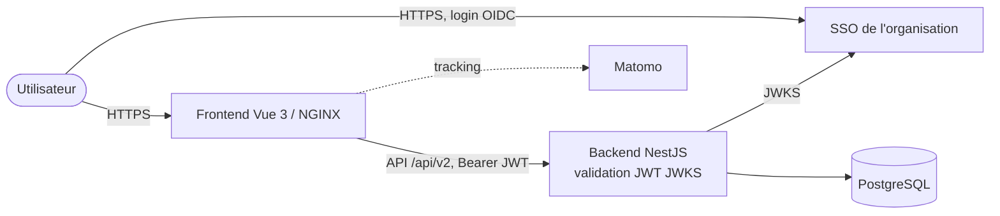

# Exploitation & déploiement

Cette page décrit la mise en production et l'exploitation du Référentiel des Applications (RefApp) : topologie des composants, images et conteneurs, pipelines de construction et de déploiement, variables d'environnement, gestion des secrets, migrations de base de données et observabilité.

Le contenu est établi à partir des fichiers réels du dépôt (`docker-compose*.yml`, `.gitlab-ci-dso.yml`, workflows GitHub Actions, `backend/Dockerfile`, `frontend/Dockerfile`, configuration NestJS). Les éléments non encore en place dans le dépôt sont explicitement marqués « prévu ».

Pour l'architecture applicative détaillée, voir [./02-architecture.md](./02-architecture.md). Pour la sécurité et les permissions, voir [./06-permissions-et-securite.md](./06-permissions-et-securite.md). Pour l'API, voir [./05-api.md](./05-api.md). Pour les zones sensibles des migrations, voir [./11-contribution.md](./11-contribution.md).

## Sommaire

1. [Topologie de déploiement](#1-topologie-de-déploiement)
2. [Images & conteneurs](#2-images--conteneurs)
3. [Pipelines de build & de déploiement](#3-pipelines-de-build--de-déploiement)
4. [Configuration & variables d'environnement](#4-configuration--variables-denvironnement)
5. [Gestion des secrets](#5-gestion-des-secrets)
6. [Base de données en production](#6-base-de-données-en-production)
7. [Observabilité & exploitation](#7-observabilité--exploitation)

## 1. Topologie de déploiement

En production, RefApp s'articule autour des composants suivants :

- **Frontend statique** : application Vue 3 compilée (`pnpm build-only`), servie par un serveur **NGINX non privilégié**. Les variables `VITE_RDA_*` sont injectées au démarrage du conteneur via un script d'entrée, ce qui permet de réutiliser une image unique entre environnements.
- **Backend NestJS** : API REST exposée sous le préfixe `/api/v2`, lancée via `pnpm start:prod` (qui applique d'abord les migrations Prisma, puis démarre `node dist/src/main.js`). C'est lui qui **valide les JWT** (signature via le JWKS du fournisseur OIDC).
- **PostgreSQL** : base de données relationnelle, accédée via Prisma.
- **Fournisseur d'identité OIDC** : en production, le **fournisseur d'identité (SSO) de l'organisation**. (En développement, un **Keycloak local**, realm `referentiel-applications`.) L'authentification est un OIDC générique piloté par variables d'environnement.
- **Matomo** : analytics web, déployé séparément (voir §2).

> Prérequis : les flux OIDC (navigateur) imposent un **contexte sécurisé HTTPS** en production. Le déploiement réel se fait sur la plateforme de déploiement de l'organisation.



Pour le détail des couches applicatives, voir [./02-architecture.md](./02-architecture.md).

## 2. Images & conteneurs

### Dockerfiles

Les deux applications utilisent un **Dockerfile multi-étapes** (`base` → `dev` / `prod`), avec passage d'un argument de build `VERSION`.

**Backend** (`backend/Dockerfile`) — base `node:24-slim`, `pnpm@10.14.0` :

- cible `dev` : `pnpm install` complet, `pnpm db:generate`, démarrage via `pnpm start:dev` ;
- cible `prod` : `pnpm install --frozen-lockfile --ignore-scripts`, génération du client Prisma, `pnpm build`, démarrage via `pnpm start:prod`. Le conteneur tourne sous l'utilisateur `node`.

**Frontend** (`frontend/Dockerfile`) — base `node:24-slim` pour le build, image finale `nginxinc/nginx-unprivileged:1.27-alpine` :

- cible `build` : génération du client d'API (`pnpm api:generate`) puis `pnpm build-only` ;
- cible `prod` : copie du `dist` dans NGINX, conteneur exécuté sous l'utilisateur `1001` (non privilégié). Le script `entrypoint.sh` injecte les variables d'environnement préfixées `VITE_RDA_` au démarrage avant de lancer NGINX.

### Différences dev vs prod (Compose)

| Fichier                   | Rôle                                                                                                                                                                                                                                                                                                                   |
| ------------------------- | ---------------------------------------------------------------------------------------------------------------------------------------------------------------------------------------------------------------------------------------------------------------------------------------------------------------------- |
| `docker-compose.yml`      | Stack de développement complète : `postgres`, `mailpit` (SMTP de test), `pgadmin`, `backend` (cible `dev`, port `3500`, hot-reload via volume), `prisma-studio`, `keycloak` (port `8082`), `client` (Vite, port `5173`).                                                                                               |
| `docker-compose.prod.yml` | Surcharge de production : remplace `backend` et `client` par des **images publiées** (`${BACK_IMAGE_TAG}` / `${FRONT_IMAGE_TAG}`, `pull_policy: always`), supprime les volumes de code et les commandes de dev, impose temporairement `AUTH_LEVEL_MODE=off`, expose le front sur `8080`, et désactive `prisma-studio`. |
| `docker-compose.ci.yml`   | Surcharge pour l'intégration continue : image `${IMAGE_TAG}`, commande `pnpm start:prod`, montage du dossier `coverage`, `AUTH_LEVEL_MODE=enforce` pour tester le refus des sessions faibles.                                                                                                                          |

En développement, le backend est exposé directement sur le port `3500` et le front (Vite) sur `5173`. En production, le front est servi par NGINX (port `8080`) et appelle le backend NestJS, qui valide lui-même les JWT.

Le contrôle du niveau d'authentification est temporairement désactivé dans le Compose de production pendant la finalisation Passage2/IAP. Réactiver `AUTH_LEVEL_MODE=enforce` après validation de la transmission des claims et des parcours d'authentification forts et faibles. La connexion OIDC et les permissions applicatives restent requises pendant cette période.

### Composants annexes (compose séparés)

- **Matomo** (`docker-compose.matomo.yml`) : service `matomo` (port `8083`) adossé à une base **MariaDB** dédiée, avec volumes persistants. Déployé indépendamment de la stack applicative.

## 3. Pipelines de build & de déploiement

Le projet combine deux chaînes complémentaires : GitHub Actions (versionnage et construction des images) et une configuration GitLab CI (`.gitlab-ci-dso.yml`, présente dans le dépôt) pour la construction et le déploiement sur la plateforme de déploiement de l'organisation.

### GitHub Actions

- **`release.yml`** : déclenché sur `push` vers `main`, utilise **release-please** pour préparer automatiquement les versions (changelog, tags `vX.Y.Z`) selon les conventional commits.
- **`release-build.yml`** : déclenché sur les tags `v*` (ou manuellement). Il appelle le workflow réutilisable de build pour le backend et le frontend, **cible `prod`**, et publie les images sur **GitHub Container Registry** (`ghcr.io/dnum-mi/referentiel-applications/{backend,frontend}`).
- **`build.yml`** : workflow réutilisable (`workflow_call`). Il se connecte à `ghcr.io`, extrait les métadonnées d'image (`docker/metadata-action`) et exécute `docker/build-push-action` avec l'argument `VERSION` issu de la référence Git.

Ces workflows assurent la **construction et la publication des images** versionnées.

### GitLab CI

`.gitlab-ci-dso.yml` est une configuration GitLab CI présente dans le dépôt. Elle s'appuie sur des templates partagés (catalogue `vault-ci.yml`, `kaniko-ci.yml`) et comporte deux étapes :

1. **`read-secret`** : lecture des secrets depuis **Vault** (`.vault:read_secret`).
2. **`docker-build`** : construction des images backend et frontend avec **Kaniko** (`.kaniko:build-push`), poussées vers un registre (`${REGISTRY_HOST}/${PROJECT_PATH}`), images `ref-app-back` / `ref-app-front` taguées par `CI_COMMIT_SHORT_SHA` et `CI_COMMIT_REF_NAME`.

Le déploiement effectif sur la plateforme de déploiement de l'organisation est piloté côté plateforme à partir des images publiées par cette CI.

## 4. Configuration & variables d'environnement

Les variables ci-dessous sont consommées par le code (`backend/src/config/configs/`, `backend/src/main.ts`, `backend/src/logger/`, frontend `VITE_RDA_*`). Les valeurs propres à l'environnement et les secrets restent dans les gestionnaires de secrets de la cible ; seuls les défauts non sensibles du code sont indiqués ici. Pour la surface fonctionnelle de l'API, voir [./05-api.md](./05-api.md).

### Backend

| Nom                                                                  | Rôle                                                                                                                                                                                                                                             |
| -------------------------------------------------------------------- | ------------------------------------------------------------------------------------------------------------------------------------------------------------------------------------------------------------------------------------------------ |
| `DATABASE_URL`                                                       | Chaîne de connexion PostgreSQL (Prisma).                                                                                                                                                                                                         |
| `OIDC_CONFIG_URL`                                                    | URL `.well-known/openid-configuration` du fournisseur OIDC (Keycloak en dev, SSO de l'organisation en prod).                                                                                                                                     |
| `OIDC_JWKS_URL`                                                      | URL de la JWKS du fournisseur OIDC pour la validation des jetons.                                                                                                                                                                                |
| `OIDC_CLIENT_ID`                                                     | Identifiant du client OIDC.                                                                                                                                                                                                                      |
| `ALLOWED_ORIGINS`                                                    | Origines CORS autorisées côté backend (liste séparée par des virgules).                                                                                                                                                                          |
| `SMTP_HOST` / `SMTP_PORT` / `SMTP_SECURE`                            | Paramètres du serveur d'envoi de courriels.                                                                                                                                                                                                      |
| `SMTP_FROM`                                                          | Adresse expéditrice des courriels.                                                                                                                                                                                                               |
| `SMTP_ENABLED`                                                       | Activation de l'envoi de courriels.                                                                                                                                                                                                              |
| `EMAIL_CRON_ENABLED`                                                 | Activation des envois automatiques (digest quotidien, relances de validation). Désactivé par défaut.                                                                                                                                             |
| `CORRELATION_CRON_ENABLED`                                           | Activation du job planifié de détection des corrélations. Désactivé par défaut.                                                                                                                                                                  |
| `TECHNOLOGY_EOL_CRON_ENABLED`                                        | Activation du recalcul global des fins de vie (3 h, appels endoflife.date). Désactivé par défaut.                                                                                                                                                |
| `TECHNOLOGY_EOL_BATCH_SIZE`                                          | Taille de lot du recalcul, entre 1 et 200 (défaut : 50). Ménage endoflife.date, pas la base.                                                                                                                                                     |
| `TECHNOLOGY_EOL_NOTIFY_ENABLED`                                      | Activation des alertes in-app de fin de vie aux gestionnaires (cron propre, 3 h 30, indépendant du recalcul et d'`ENDOFLIFE_ENABLED`, #2519). Désactivée par défaut.                                                                             |
| `ENDOFLIFE_ENABLED`                                                  | `false` coupe tout appel à endoflife.date, fiches et recalcul planifié compris (les fiches affichent « Non vérifiée »). Actif par défaut.                                                                                                        |
| `HTTP_PROXY` / `HTTPS_PROXY` / `NO_PROXY`                            | Proxy sortant honoré nativement par les appels hors SI : endoflife.date, scan EcoIndex (voir l'encadré).                                                                                                                                         |
| `CORRELATION_SCORE_THRESHOLD`                                        | Score minimal inclusif (0 à 1) pour proposer une paire. Défaut `0.6`.                                                                                                                                                                            |
| `CORRELATION_WEIGHT_NAME`                                            | Poids du signal « similarité de nom » dans le score. Défaut `0.6`.                                                                                                                                                                               |
| `CORRELATION_WEIGHT_DATA`                                            | Poids du signal « données partagées » dans le score. Défaut `0.25`.                                                                                                                                                                              |
| `CORRELATION_WEIGHT_ACTORS`                                          | Poids du signal « acteurs communs » dans le score. Défaut `0.15`.                                                                                                                                                                                |
| `PORT` / `HOST`                                                      | Port et interface d'écoute du backend (par défaut `3500` / `0.0.0.0`).                                                                                                                                                                           |
| `NODE_ENV`                                                           | Environnement d'exécution Node.                                                                                                                                                                                                                  |
| `ENV_LABEL`                                                          | Libellé d'environnement affiché dans l'interface.                                                                                                                                                                                                |
| `VERSION`                                                            | Version applicative (injectée au build / runtime).                                                                                                                                                                                               |
| `MAINTENANCE_MODE`                                                   | Force le mode maintenance lecture seule (`true`, `1` ou `yes`).                                                                                                                                                                                  |
| `MAINTENANCE_CACHE_TTL_MS`                                           | Durée de cache de la détection `pg_is_in_recovery()` en millisecondes (défaut : `30000`).                                                                                                                                                        |
| `LOG_LEVEL`                                                          | Niveau de journalisation (Pino).                                                                                                                                                                                                                 |
| `ONLY_WRITE_SWAGGER`                                                 | Génère le fichier Swagger puis s'arrête (option d'outillage).                                                                                                                                                                                    |
| `WRITE_SWAGGER_YAML`                                                 | Active/désactive l'écriture du Swagger en YAML.                                                                                                                                                                                                  |
| `FOOTER_LINKS`                                                       | Liens de pied de page (JSON).                                                                                                                                                                                                                    |
| `DISABLE_JWT_VALIDATION`                                             | Seule la valeur `true` désactive la vérification JWT, avec avertissement. Le démarrage est refusé sauf si `NODE_ENV=development` est explicitement défini. `false`, `0`, vide ou absent conservent la vérification.                              |
| `OIDC_SCOPE`                                                         | Scopes OIDC demandés par le frontend (défaut : `openid profile email`) ; à ajuster si le claim de niveau d'authentification est servi dans un scope dédié.                                                                                       |
| `AUTH_LEVEL_MODE`                                                    | Contrôle du niveau d'authentification (#1985) : `off` (défaut), `observe` ou `enforce`. Voir l'encadré d'activation ci-dessous.                                                                                                                  |
| `AUTH_LEVEL_CLAIM` / `AUTH_LEVEL_STRONG_VALUES`                      | Nom du claim de mode d'authentification et valeurs valant authentification forte (CSV). Obligatoires dès que le mode n'est pas `off` : sinon échec au démarrage.                                                                                 |
| `AUTH_LEVEL_IDP_CLAIM` / `AUTH_LEVEL_TRUSTED_IDPS`                   | Claim du fournisseur d'identité d'origine et liste (CSV, vide par défaut) des fournisseurs fédérés dont l'identification vaut authentification forte.                                                                                            |
| `AUTH_LEVEL_REAUTH_ENABLED` / `_PROMPT` / `_ACR_VALUES` / `_MAX_AGE` | Reconnexion forte proposée par le front (`true` / `login` par défaut ; `acr_values` et `max_age` optionnels).                                                                                                                                    |
| `AUTH_LEVEL_HELP_URL`                                                | Page d'aide (carte agent, activation de la double authentification) liée depuis le bandeau.                                                                                                                                                      |
| `AUTH_LEVEL_REAUTH_STRATEGY`                                         | Reconnexion forte : `prompt` (défaut) ou `logout` (déconnexion SSO complète puis reconnexion). Le front bascule seul sur `logout` après une tentative restée faible.                                                                             |
| `AUTH_LEVEL_USERINFO_FALLBACK` / `_URL` / `_TIMEOUT_MS`              | Repli userinfo quand le claim de mode manque sur l'access token (désactivé par défaut) ; URL explicite ou lue dans le document de découverte ; délai (défaut 2000 ms).                                                                           |
| `AUTH_LEVEL_USERINFO_HMAC_ALGORITHM` / `_CLIENT_SECRET`              | Vérification de userinfo signé en `HS256`, `HS384` ou `HS512` avec le secret du client OIDC. Les deux variables sont requises ensemble ; signature imposée et secret exclusivement serveur. Sans elles : JSON ou signature par JWKS.             |
| `MAIA_API_URL`                                                       | URL du service d'organisation MAIA.                                                                                                                                                                                                              |
| `MAIA_TIMEOUT_MS`                                                    | Délai maximal d’une requête MAIA, lecture du corps comprise : `5000` ms par défaut, entier de `1` à `60000`. Une valeur invalide revient à `5000` et produit un avertissement.                                                                   |
| `MOCK_MAIA_SERVICE` / `MOCK_MAIA_ORGANIZATION`                       | Mode bouchonné du service MAIA (dev/test).                                                                                                                                                                                                       |
| `GRIST_ENCRYPTION_KEY`                                               | Secret de chiffrement des clés d'API Grist en base (AES-256-GCM, clé dérivée par SHA-256). Chaîne longue et aléatoire, à garder dans le coffre et à ne jamais changer sans faire ressaisir les clés : sans elle, la synchronisation renvoie 503. |
| `GRIST_TIMEOUT_MS`                                                   | Délai maximal d'une requête Grist : `30000` ms par défaut, entier de `1` à `300000`. Une valeur invalide revient à `30000` et produit un avertissement.                                                                                          |

> **Synchronisation Grist** : le bouton « Synchroniser avec Grist » de la recherche écrit dans Grist ce que la page affiche : les applications qui correspondent aux filtres (mêmes filtres, millésime et texte libre compris, et même périmètre que la recherche), avec les colonnes visibles du tableau et les mêmes valeurs (libellés, `%`, `h`, Oui/Non, dates au format français). Les colonnes réservées à la capacité `ColumnRead` (MOA, MOE, hébergement, conformité…) ne sont jamais écrites pour un utilisateur qui ne l'a pas, même s'il les demande à l'API. L'upsert se fait sur `refapp_id` : les métadonnées saisies dans Grist sont conservées.
>
> **Colonnes** : RefApp écrit `refapp_id`, `dans_selection` (case cochée si l'application est dans la sélection) puis une colonne par colonne visible du tableau, avec un identifiant fixe (`iq`, `nom`, `priorite`, `hebergement`, `tags`, `moa`, `moe`, `fournisseur`, `plateforme`, `responsable_hebergement`, `direction_metier`, `rsimm`, `dima`, `pdma`, `rgaa`, `dsfr`, `rgpd`, `pra`, `homologation`, `date_fin_homologation`, `statut`, `nb_consultations`, `maturite_technique`, `maturite_metier`, `maitrise_couts_mco`) et l'en-tête de la page comme libellé ; renommer une colonne dans Grist ne change pas son identifiant. Les colonnes d'une table existante suivent le tableau : une colonne affichée qui manque est ajoutée, avant les colonnes ajoutées dans Grist et dans chaque vue ; une colonne RefApp qui n'est plus affichée est supprimée, avec ses valeurs. `dans_selection` est retirée des vues quand RefApp la crée (elle reste dans les données brutes) : elle ne sert qu'au style grisé, posé sur chaque colonne, y compris les métadonnées ajoutées depuis. La colonne `motif_sortie` des premières versions est supprimée à la première synchronisation. La disposition n'est pas modifiée quand aucune colonne n'est ajoutée.
>
> **Métadonnées** : ce sont les colonnes de données ajoutées dans Grist, quel que soit leur nom. RefApp ne les crée pas, n'y écrit jamais et ne les supprime pas. Une colonne ajoutée dans Grist avec l'identifiant d'une colonne RefApp (par exemple `moa`) est traitée comme une colonne RefApp. Les colonnes formule sont calculées : elles ne comptent pas comme métadonnées.
>
> Chaque utilisateur qui a la capacité `GristSync` renseigne dans son profil (onglet **Synchronisation Grist**, visible seulement avec cette capacité) l'adresse HTTPS de son instance Grist, sa clé d'API et les identifiants des documents à mettre à jour, 20 au plus. Son compte Grist doit être propriétaire de ces documents. La clé d'API est chiffrée dans `User.gristApiKey` (`v1:<iv>:<tag>:<chiffré>`, secret `GRIST_ENCRYPTION_KEY`) et n'est jamais renvoyée par l'API : Prisma l'omet de toutes les lectures de `User` sauf sélection explicite, et seule la synchronisation la déchiffre. Une clé illisible (enregistrée en clair, ou secret changé) est refusée : l'utilisateur doit la ressaisir. Sans adresse, clé ou document, le bouton est désactivé. Les documents sont synchronisés l'un après l'autre et indépendamment : un document en échec (droits, document introuvable) est signalé sans bloquer les autres.
>
> Au clic, une fenêtre liste les documents du profil et, pour chacun, les tables créées par RefApp (`GET /grist/tables`). L'utilisateur choisit pour chaque document une table existante ou une **nouvelle table** ; un document illisible est écarté. Par défaut, c'est la première table du document, ou une nouvelle table s'il n'en a pas. Une nouvelle table prend le premier nom libre parmi `RefApp`, `RefApp2`, `RefApp3`… Une table `RefApp…` sans colonne `refapp_id` n'a pas été créée par RefApp : elle n'est jamais modifiée ni proposée. Appelé sans `targets`, `POST /grist/setup` synchronise chaque document du profil dans sa première table.
>
> - **Application hors sélection, avec au moins une métadonnée remplie** : la ligne est conservée et grisée (`dans_selection` décochée). Ses colonnes RefApp restent à jour tant que l'utilisateur peut lire l'application (par exemple une application passée au statut « Supprimée »). Elles gardent leurs dernières valeurs si l'application a été effacée de RefApp ou est sortie de son périmètre.
> - **Application hors sélection, sans métadonnée remplie** : la ligne est supprimée. Une cellule vide, un `0` ou une case décochée ne comptent pas comme remplis : ce sont les valeurs par défaut de Grist.
> - **Application qui revient dans la sélection** : sa ligne est réutilisée et mise à jour.
>
> Chaque table contient une sélection. Une synchronisation vers une table existante avec d'autres filtres retire les lignes de la précédente qui n'ont pas de métadonnée, y compris celles écrites par un autre utilisateur qui synchronise la même table. Pour garder plusieurs sélections dans un même document, il faut synchroniser chacune dans sa propre table. Chaque `setup` supprime les règles d'accès de la table synchronisée qu'il n'a pas posées, y compris celles ajoutées à la main dans Grist.
>
> **Verrou** : les Access Rules posées par RefApp s'appliquent à tous, propriétaires du document compris. Elles rendent non modifiables les colonnes écrites par RefApp et interdisent d'ajouter ou de supprimer des lignes ; les métadonnées restent modifiables. La synchronisation, faite avec la clé d'un propriétaire, retire ces règles le temps d'écrire puis les remet, même en cas d'échec. Pendant la synchronisation, de quelques secondes à quelques dizaines de secondes, la table n'est donc pas verrouillée ; si le backend s'arrête en cours de route, le verrou est remis à la synchronisation suivante. Deux synchronisations simultanées d'un même document peuvent se gêner : l'une d'elles est alors signalée en échec. Un propriétaire peut toujours retirer les règles à la main dans Grist : c'est un garde-fou contre les erreurs, pas une protection contre un propriétaire qui veut le contourner.

> **Activer le contrôle du niveau d'authentification (#1985)** — le code utilise `AUTH_LEVEL_MODE=off` par défaut. La configuration d’infrastructure publiée ne prouve ni son déploiement ni la qualification du SSO. Le [guide IAP](./13-integration-iap.md) détaille les claims du scope `profile`, les redirections, la commande Passage2 et la vérification HMAC.
>
> 1. **Configurer le fournisseur** : déclarer les claims de mode et de fournisseur sur l’access token ou `userinfo`, dans le scope `profile` ou un scope dédié (`OIDC_SCOPE`). Configurer `AUTH_LEVEL_CLAIM`, `AUTH_LEVEL_IDP_CLAIM` et les valeurs fortes documentées. Avec `AUTH_LEVEL_USERINFO_FALLBACK=true`, le backend doit joindre le document de découverte et l’endpoint `userinfo`, ou l’URL explicite `AUTH_LEVEL_USERINFO_URL`. Le sujet du jeton doit être non vide et identique dans la réponse ; une réponse signée exige aussi l’émetteur et l’audience attendus.
> 2. **Observer en integ puis qualif** pendant au moins une semaine, en `observe` : droits intacts, niveau visible dans le profil. Le journal conserve chaque contexte quotidien distinct (niveau, mode, fournisseur, source), même si deux modes sont encore classés faibles. `SELECT "authLevel", "authMethod", "authIdp", "authSource", count(*) FROM "UserConnexionLog" WHERE "authTime" >= current_date - 7 GROUP BY 1, 2, 3, 4` compte les contextes quotidiens, pas les connexions. `authSource` vaut `token`, `userinfo`, ou `null` pour les anciennes lignes et les sessions sans évaluation. Les lignes `[AuthLevel]` donnent le détail par compte. Le même diagnostic est consultable sans SQL via **Administration → Utilisateurs & droits → Gestion des utilisateurs → Consultation → Connexions**, dans une fenêtre dédiée réservée aux administrateurs dans leur périmètre.
> 3. **Qualifier les quatre parcours réels** : carte agent, Windows seul, mot de passe seul et RIO/mot de passe + TOTP. La valeur `CARD` couvre les deux parcours forts : conserver `AUTH_LEVEL_STRONG_VALUES=CARD`. Vérifier sa transmission, la provenance des claims, le refus des parcours sans second facteur et le retour de reconnexion. Les fixtures Keycloak ne prouvent pas le comportement du SSO institutionnel. Maintenir `observe` tant que ces parcours ne sont pas validés.
> 4. **Activer `enforce`** (refus de toute consultation, y compris le profil, pour une session faible ou inconnue) en qualif puis en production, en heure creuse, après la campagne QA permissions. **Retour arrière** : repasser en `observe` et redémarrer les instances pour appliquer leur environnement ; aucun changement de code n’est nécessaire. La migration conserve les anciennes lignes et reste compatible avec les anciens serveurs pendant un déploiement progressif.
>
> **Diagnostic** : `claim-missing` ou `untrusted-idp` signifie que le mode n’a pas été établi. Vérifier le mapper, le scope, le repli `userinfo` et ses erreurs avant de modifier la liste de confiance. `untrusted-idp` peut aussi concerner le fournisseur principal et ne prouve pas une fédération. Un mode faible explicite, sur le jeton ou `userinfo`, prime toujours sur cette liste. La reconnexion est proposée si elle est activée : après un échec de `prompt=login`, l'écran de refus propose la déconnexion SSO complète ; `AUTH_LEVEL_REAUTH_STRATEGY=logout` impose cette voie dès le premier clic. Un nouvel échec oriente vers le support, y compris après rechargement de l’onglet. Un mode actif sans claim ou valeurs fortes refuse de démarrer. `DISABLE_JWT_VALIDATION` reste réservé au développement.

> **Indisponibilité MAIA** : une panne réseau, un dépassement de délai ou une réponse invalide ne bloque pas la première connexion : le compte est créé avec le rôle Visiteur, sans organisation, et un avertissement `[MAIA]` est journalisé. Après rétablissement, relancer la synchronisation MAIA depuis l’administration avec `onlyMissing=true` pour compléter ces comptes. Une synchronisation individuelle en erreur répond `503` sans modifier l’organisation existante. Le batch poursuit après chaque échec et journalise un bilan `processed`, `synced`, `notFound`, `failed` ; une absence dans l’annuaire est comptée séparément d’une panne.

> **Appels sortants hors SI (fins de vie via endoflife.date, scan EcoIndex)** : ils passent par le `fetch` d'undici avec un `EnvHttpProxyAgent` commun (`backend/src/common/http/outbound-dispatcher.ts`), qui honore `HTTP_PROXY` / `HTTPS_PROXY` / `NO_PROXY` (majuscules ou minuscules) **sans** qu'il soit nécessaire de poser `NODE_USE_ENV_PROXY=1` — le `fetch` global de Node ignore ces variables tant que ce flag n'est pas défini. Le dispatcher n'est pas global : les autres appels sortants du backend (MAIA, JWKS OIDC) sont internes au SI et ne sont pas routés vers le proxy. Pour diagnostiquer, trois contextes de log. **`OutboundHttp`** : au premier appel sortant, quel que soit le flux, une ligne annonce le proxy retenu (hôte:port, identifiants masqués ; cibles HTTPS et HTTP distinguées quand `HTTPS_PROXY` et `HTTP_PROXY` diffèrent — sans `HTTP_PROXY`, une cible HTTP part en direct) ou l'accès direct, et une ligne `error` si l'URL de proxy est inutilisable (schéma `http://` manquant, par exemple) — tout appel sortant échoue alors jusqu'à correction. **`Endoflife`** : chaque échec vers endoflife.date (délai dépassé, erreur réseau avec son code — `ECONNREFUSED`, `ENOTFOUND`… —, statut HTTP) est tracé en `warn` avec l'URL et la durée, au plus une fois par URL et par minute. Un 404 sur l'URL du catalogue est lui aussi tracé (il ne vient jamais d'endoflife.date : proxy ou filtrage d'URL qui répond à sa place), alors qu'un 404 sur une URL produit signifie « produit non suivi » et reste silencieux. Après un échec (hors 404 produit), une ligne `warn` « endoflife.date injoignable : résolutions court-circuitées pendant 60 s » annonce l'ouverture du disjoncteur (#2513) : pendant une minute aucune requête n'est tentée, les fiches consultées affichent « Non vérifiée » sans écriture, puis le prochain appel réessaie. **`EcoIndex`** : chaque échec du scan (délai dépassé, erreur réseau, redirection refusée, statut HTTP) est tracé en `warn` avec l'hôte cible (jamais l'URL complète, qui peut porter des paramètres sensibles) et la durée, sans limitation — un scan est déclenché à la main. Aucune ligne `OutboundHttp` du tout : aucun appel sortant n'a été tenté (`ENDOFLIFE_ENABLED=false`, qui coupe aussi le recalcul planifié ; aucune fiche consultée ; aucun scan arrivé jusqu'à l'appel). Une ligne d'annonce sans `warn` et pourtant aucune fin de vie affichée : le produit n'est pas connu du catalogue (état « Produit non suivi » sur la fiche), la version saisie ne correspond à aucun cycle (état « Version non reconnue » sur la fiche, #2449), ou le premier `warn` a été émis plus d'une minute plus tôt ; vérifier aussi que `LOG_LEVEL` laisse passer `warn`. Un scan EcoIndex refusé par la garde anti-SSRF (URL invalide, hôte introuvable, adresse interne) est tracé en `warn` sous `EcoIndex` **sans** ligne `OutboundHttp` : le dispatcher n'est jamais sollicité. Derrière un proxy, un 400 « Hôte de l'URL cible EcoIndex introuvable » signifie que le pod ne résout pas les noms externes : la garde exige le DNS local même si le proxy sait résoudre de son côté. Une fois la garde passée, c'est le proxy qui résout l'hôte cible : la garde rejette toujours les IP et hôtes internes déclarés, mais c'est la politique du proxy qui cloisonne le chemin réel.

### Frontend (`VITE_RDA_*`)

| Nom                       | Rôle                                  |
| ------------------------- | ------------------------------------- |
| `VITE_RDA_MATOMO_URL`     | URL de l'instance Matomo (analytics). |
| `VITE_RDA_MATOMO_SITE_ID` | Identifiant du site Matomo.           |

> Les variables `VITE_RDA_*` sont injectées **au démarrage du conteneur frontend** (script d'entrée NGINX), pas au moment du build, ce qui permet de promouvoir une même image entre environnements.

## 5. Gestion des secrets

**Aucun secret n'est stocké en dur dans le dépôt.** La gestion des secrets se fait via Vault et/ou SOPS.

Bonnes pratiques en vigueur :

- **Vault** pour la diffusion des secrets en CI/CD et au déploiement (la CI lit ses secrets via une étape Vault dédiée).
- **SOPS (age)** comme complément de chiffrement des fichiers de configuration sensibles.
- Variables sensibles fournies par l'environnement d'exécution (jamais commitées), distinction nette entre configuration non sensible et secrets.
- Régénération des secrets en cas de fuite suspectée.

Les valeurs en clair présentes dans `docker-compose.yml` (mots de passe `postgres`, `pgadmin`, Keycloak) concernent **exclusivement le développement local** et ne doivent jamais être réutilisées en production.

## 6. Base de données en production

Les migrations sont appliquées via **Prisma Migrate** :

- script `db:deploy` → `prisma migrate deploy` ;
- au démarrage en production, `start:prod` exécute `prisma migrate deploy` **avant** de lancer l'application, garantissant un schéma à jour.

Zone sensible : certaines migrations dépassent le simple schéma généré par Prisma (contraintes **CHECK**, **migrations de données SQL**, **vues SQL**). Toute évolution doit être revue avec prudence et testée ; les règles et précautions sont décrites dans [./11-contribution.md](./11-contribution.md).

> **Prévu (roadmap)** : évolution vers un **opérateur PostgreSQL Kubernetes (CloudNativePG / CNPG)** pour l'exploitation managée de la base en production (haute disponibilité, sauvegardes, réplication). Cet enabler est suivi dans la feuille de route et n'est pas encore matérialisé dans le dépôt.

## 7. Observabilité & exploitation

- **Health-check** : le backend expose l'endpoint `GET /api/v2/health-check`. Il vérifie PostgreSQL et renvoie `{ maintenance, version, etat: "OK" }` ; en cas d'échec de connexion, il répond `503 Service Unavailable` avec `etat: "KO"`. Le champ `maintenance` combine le forçage manuel et la détection de réplication PostgreSQL.
- **Logs** : journalisation structurée via **Pino** (`nestjs-pino`), niveau configurable par `LOG_LEVEL` (défaut `info`, `debug` en développement). Le format est adapté selon `NODE_ENV`.
- **Analytics** : suivi d'usage via **Matomo** côté frontend (variables `VITE_RDA_MATOMO_*`), déployé en compose séparé.
- **Sécurité HTTP** : le backend active **Helmet** et un **CORS** restreint aux origines autorisées. Les flux OIDC (côté navigateur) requièrent un **contexte sécurisé HTTPS** en production, quel que soit le fournisseur (Keycloak en dev, SSO de l'organisation en prod).

### Protection des jetons dans les journaux HTTP

Les en-têtes `Authorization` et `x-refapp-token` sont retirés des objets de requête sérialisés par Pino, y compris sur les réponses de refus et les erreurs serveur. Le journal détaillé des requêtes masque également ces deux en-têtes avant de sérialiser son contexte en texte. Les en-têtes de la requête originale restent disponibles pour l'authentification.

Le correctif de #2927 protège les nouvelles sorties après déploiement ; il ne modifie pas les historiques déjà collectés. L'exploitation doit évaluer ces historiques avec les responsables de la sécurité :

1. Délimiter les environnements, la période, les collecteurs et les copies concernés à partir des versions déployées et des flux de collecte. Vérifier la présence d'en-têtes sensibles dans l'outil de journalisation autorisé, avec un résultat de présence ou un compte rendu agrégé ; ne pas exporter ni recopier les valeurs des jetons dans un ticket, un message ou une commande conservée dans l'historique.
2. Restreindre l'accès aux journaux concernés et faire régénérer ou révoquer les jetons personnels, machine ou délégués potentiellement exposés. Coordonner le remplacement des jetons des intégrations avec leurs responsables, puis vérifier les accès avec les nouveaux jetons et le refus des anciens. Appliquer les procédures du fournisseur d'identité pour les sessions Bearer concernées, si nécessaire.
3. Recenser les index, exports, archives et sauvegardes contenant ces journaux. Faire approuver leur assainissement, leur suppression ou leur conservation à accès restreint selon la politique de conservation et les besoins d'investigation ; la correction du code ne justifie pas une purge automatique des preuves.
4. Après déploiement sur toutes les instances, envoyer uniquement des marqueurs synthétiques dans ces deux en-têtes et vérifier leur absence des sorties locales et des collecteurs, sur les parcours de succès, de refus et d'erreur. Consigner la version, la date de déploiement, les périmètres vérifiés et les décisions de traitement, sans valeur secrète.

Cette procédure reste à exécuter et à attester par l'exploitation sur les environnements concernés. Voir aussi [Gestion des secrets](#5-gestion-des-secrets).

### Calibrer la détection des corrélations

Le moteur utilise `backend/src/config/configs/correlation.config.ts`. Les valeurs par défaut
sont `CORRELATION_CRON_ENABLED=false`, `CORRELATION_SCORE_THRESHOLD=0.6`,
`CORRELATION_WEIGHT_NAME=0.6`, `CORRELATION_WEIGHT_DATA=0.25` et `CORRELATION_WEIGHT_ACTORS=0.15`.
Seule la chaîne `true` active le cron, exécuté chaque jour à **04:00, fuseau `Europe/Paris`**.
Le lancement manuel via `POST /api/v2/correlation-suggestions/run` reste disponible quand le
cron est désactivé, avec la permission `GlobalAdminManage`.

Le seuil est inclusif (`score >= seuil`). Seuil et poids acceptent chacun un nombre fini
entre 0 et 1, avec un point décimal. Une valeur invalide, comme `0,6` ou `1.2`, déclenche un
avertissement et reprend le défaut du paramètre. Les poids ne sont pas renormalisés : leur
somme n'est pas imposée à 1, et un autre réglage peut donc produire un score supérieur à 1.

Un verrou en mémoire empêche deux détections simultanées **dans la même instance**. Il ne
coordonne pas plusieurs réplicas backend. Un déclenchement manuel concurrent reçoit `409` ;
le cron ignore un passage déjà en cours. Les journaux indiquent les candidats, les créations
et les rafraîchissements. Un nouveau passage ne purge pas les anciennes suggestions
`PENDING` devenues inéligibles et ne rouvre pas les décisions `ACCEPTED` ou `REJECTED`.

`CORRELATION_SCORE_THRESHOLD` et les trois poids se calibrent sur les données de l'environnement.
La requête ci-dessous, en lecture seule, explore les candidats par nom et les données utilisées
en commun ; elle n'inclut pas tous les candidats par données ou acteurs, ni toutes les exclusions
du moteur. Ses comptes constituent un échantillon de calibrage, pas une prévision exacte des
créations du prochain passage. La formule complète est décrite dans les
[fonctionnalités](./07-fonctionnalites.md#détection-et-revue-des-corrélations).

```sql
WITH poids AS (
  SELECT 0.6::float8 AS w_nom, 0.25::float8 AS w_donnees, 0.15::float8 AS w_acteurs
),
paires_nom AS (
  SELECT a.id AS id_a, b.id AS id_b
  FROM "Application" a JOIN "Application" b ON a.id < b.id
  WHERE a.label % b.label
  UNION
  SELECT a.id, b.id
  FROM "Application" a JOIN "Application" b ON a.id < b.id
  WHERE a."shortName" IS NOT NULL AND b."shortName" IS NOT NULL
    AND a."shortName" % b."shortName"
),
signaux AS (
  SELECT p.id_a, p.id_b,
         GREATEST(similarity(a.label, b.label),
                  0.8 * COALESCE(similarity(a."shortName", b."shortName"), 0))::float8 AS nom,
         COALESCE((SELECT count(DISTINCT da1."dataDescriptionId")
                   FROM "DataApplication" da1 JOIN "DataApplication" da2
                     ON da1."dataDescriptionId" = da2."dataDescriptionId"
                   WHERE da1."applicationId" = p.id_a AND da2."applicationId" = p.id_b), 0) AS donnees,
         COALESCE((SELECT count(DISTINCT lower(a1.email))
                   FROM "Actor" a1 JOIN "Actor" a2 ON lower(a1.email) = lower(a2.email)
                   WHERE a1."applicationId" = p.id_a AND a2."applicationId" = p.id_b
                     AND a1.email IS NOT NULL AND a1.email <> ''), 0) AS acteurs
  FROM paires_nom p
  JOIN "Application" a ON a.id = p.id_a
  JOIN "Application" b ON b.id = p.id_b
),
scores AS (
  SELECT s.*, (w_nom * nom + w_donnees * LEAST(donnees / 3.0, 1) + w_acteurs * LEAST(acteurs / 2.0, 1))::float8 AS score
  FROM signaux s, poids
)
SELECT seuil, count(*) FILTER (WHERE score >= seuil) AS suggestions
FROM scores, (VALUES (0.40), (0.45), (0.50), (0.55), (0.60), (0.65), (0.70)) AS t(seuil)
GROUP BY seuil ORDER BY seuil;
```

Remplacer le `SELECT` final par celui-ci pour examiner les paires les mieux notées avant de fixer le seuil :

```sql
SELECT round(score::numeric, 3) AS score, round(nom::numeric, 2) AS nom, donnees, acteurs,
       a.label AS application_a, b.label AS application_b
FROM scores s
JOIN "Application" a ON a.id = s.id_a
JOIN "Application" b ON b.id = s.id_b
ORDER BY score DESC LIMIT 20;
```

**Deux points à connaître avant de choisir une valeur.**

Avec le poids du nom par défaut de `0.6`, deux libellés strictement identiques atteignent le
seuil `0.6` sans autre signal et peuvent être proposés. Une suggestion reste soumise à une
revue humaine : un libellé commun peut aussi désigner des instances distinctes.

Le nom court est minoré d'un facteur `0.8` avant comparaison avec le libellé. Avec les poids
par défaut, deux noms courts identiques seuls valent `0.48`, sous le seuil ; ils nécessitent
un autre signal suffisant. Examiner les paires les mieux notées aide à régler le moteur.
Aucune fusion automatique de fiches n'a lieu, même après acceptation d'une suggestion.

---

## Récapitulatif

**Fichiers de déploiement réels vérifiés :**

- `docker-compose.yml`, `docker-compose.prod.yml`, `docker-compose.ci.yml`, `docker-compose.matomo.yml`
- `pgadmin.json`
- `backend/Dockerfile`, `frontend/Dockerfile`
- `.github/workflows/build.yml`, `release-build.yml`, `release.yml`
- `.gitlab-ci-dso.yml`
- `backend/src/config/configs/` (app, oidc, auth-level, database, email), `backend/src/main.ts`, `backend/src/logger/logger.module.ts`, `backend/src/health/health-check.controller.ts`, `backend/package.json`

**Variables d'environnement vérifiées dans le code :** `DATABASE_URL` ; `OIDC_CONFIG_URL`, `OIDC_JWKS_URL`, `OIDC_CLIENT_ID` ; `ALLOWED_ORIGINS` ; `SMTP_HOST/PORT/SECURE/FROM/ENABLED` ; `PORT`, `HOST`, `NODE_ENV`, `ENV_LABEL`, `VERSION` ; `MAINTENANCE_MODE`, `MAINTENANCE_CACHE_TTL_MS` ; `LOG_LEVEL` ; `ONLY_WRITE_SWAGGER`, `WRITE_SWAGGER_YAML` ; `FOOTER_LINKS`, `DISABLE_JWT_VALIDATION` ; `OIDC_SCOPE`, `AUTH_LEVEL_MODE`, `AUTH_LEVEL_CLAIM`, `AUTH_LEVEL_STRONG_VALUES`, `AUTH_LEVEL_IDP_CLAIM`, `AUTH_LEVEL_TRUSTED_IDPS`, `AUTH_LEVEL_REAUTH_ENABLED`, `AUTH_LEVEL_REAUTH_PROMPT`, `AUTH_LEVEL_REAUTH_ACR_VALUES`, `AUTH_LEVEL_REAUTH_MAX_AGE`, `AUTH_LEVEL_REAUTH_STRATEGY`, `AUTH_LEVEL_USERINFO_FALLBACK`, `AUTH_LEVEL_USERINFO_URL`, `AUTH_LEVEL_USERINFO_TIMEOUT_MS`, `AUTH_LEVEL_HELP_URL` ; `MAIA_API_URL`, `MAIA_TIMEOUT_MS`, `MOCK_MAIA_SERVICE`, `MOCK_MAIA_ORGANIZATION` ; `GRIST_TIMEOUT_MS`, `GRIST_ENCRYPTION_KEY` ; `VITE_RDA_MATOMO_URL`, `VITE_RDA_MATOMO_SITE_ID`.

**Éléments marqués « prévu » :** migration vers l'opérateur PostgreSQL Kubernetes **CloudNativePG (CNPG)** (enabler de la feuille de route, non présent dans le dépôt).
